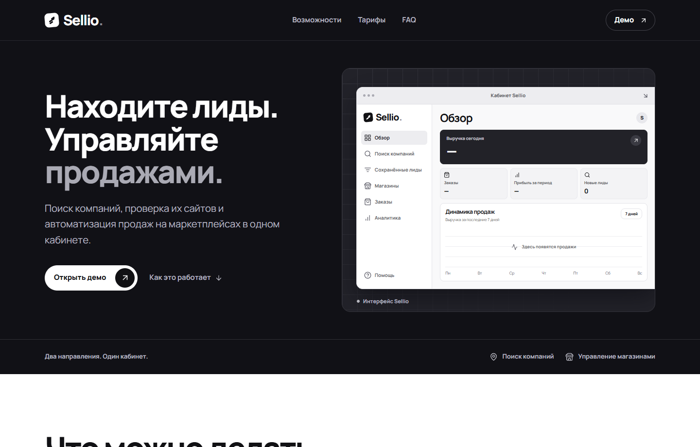

# Sellio

Русскоязычный кабинет для поиска компаний и управления продажами цифровых товаров. Лендинг и кабинет используют общие токены Handwerk и шрифт Manrope.

[Публичное демо на GitHub Pages](https://anotherulez.github.io/sellio/)



В публичной версии доступны лендинг, FAQ и обзор интерфейса кабинета. Для регистрации, поиска, подписок и интеграций запустите серверную версию.

## Локальный запуск

Требуется Node.js 24.4 или новее и npm. Команды выполняются из папки `sellio`.

```powershell
npm ci
Copy-Item .env.example .env.local
node -e "console.log(require('node:crypto').randomBytes(32).toString('base64'))"
```

Запишите сгенерированное значение в `SELLIO_ENCRYPTION_KEY`. Сгенерируйте второй секрет для `OWNER_BOOTSTRAP_SECRET`, если нужен доступ владельца. Запустите приложение и фоновый процесс в отдельных терминалах.

```powershell
npm run dev
npm run worker
```

Веб-приложение открывается по адресу `http://127.0.0.1:3000`. Локальные письма появляются в терминале веб-приложения при `SELLIO_DEV_MAIL=console`. После перехода по ссылке подтвердите адрес на странице и войдите. Тестовые тарифы доступны в разделе «Подписка» при `SELLIO_PAYMENT_MODE=test`. Операции записываются с нулевой суммой и пометкой тестового режима.

Владелец регистрируется с собственным паролем на адрес из `OWNER_EMAIL`, подтверждает почту и вводит код из окружения в настройках. Повторное назначение блокируется базой. После назначения уберите секрет из окружения. Администрация открывается по адресу `/admin`.

## Источники компаний

| API | Ключ | Разрешение на CRM | Разрешение на выгрузку |
| --- | --- | --- | --- |
| [Яндекс Карты](https://yandex.ru/maps-api/products/geosearch-api) | `YANDEX_MAPS_KEY` | `YANDEX_MAPS_CRM_ALLOWED` | `YANDEX_MAPS_CSV_ALLOWED` |
| [2ГИС Places](https://docs.2gis.com/en/api/search/places/overview) | `TWO_GIS_KEY` | `TWO_GIS_CRM_ALLOWED` | `TWO_GIS_CSV_ALLOWED` |
| [Google Places](https://developers.google.com/maps/documentation/places/web-service/policies) | `GOOGLE_MAPS_KEY` | `GOOGLE_MAPS_CRM_ALLOWED` | `GOOGLE_MAPS_CSV_ALLOWED` |

Устанавливайте флаги в `true` после проверки условий договора для конкретного сценария. Флаг CRM означает разрешение извлекать, проверять и сохранять указанные поля в этом кабинете. Для Google Maps держите его выключенным, пока объём прав на хранение и CRM не подтверждён отдельно. Перед включением согласуйте требуемую атрибуцию и требования к показу данных. Для 2ГИС флаг `TWO_GIS_CONTACTS_ALLOWED` включает поле `items.contact_groups` при наличии доступа. Настройте внутренний лимит запросов в пределах лицензии. Выключение источника скрывает данные и прекращает новые выгрузки. Если истекают договорные сроки хранения, удалите соответствующие записи из БД и резервных копий согласно договору.

Поиск обрабатывается фоновым процессом. Результаты задания хранятся до семи дней, сохранённые лиды — пока пользователь или оператор их не удалит. Приложение показывает название источника, публичный рабочий телефон и ссылку на карточку, если поля доступны. Измерение скорости означает время серверного запроса. Метатег viewport, заголовок и язык документа — признаки базовой проверки HTML. Полный аудит в браузере, Core Web Vitals и WCAG требуют отдельного инструмента.

## Продажи и уведомления

Синхронизация GGSEL и Plati Market использует [кабинет и API Digiseller](https://my.digiseller.com/inside/api.asp). По каждой площадке включайте свой флаг только для магазинов с разрешённым API. Нужны собственные ID и ключ продавца с правами просмотра товаров и статистики. Синхронизация запускается вручную, читает лоты и рублёвые продажи за последние 30 дней. При превышении объёма 1 000 строк за запрос операция сообщает об ошибке. Себестоимость вводится в заказах. Если данных не хватает, прибыль отображается прочерком.

Для уведомлений создайте собственного бота через BotFather, откройте чат с ботом и укажите его токен и числовой ID чата. В кабинете можно проверить соединение, просмотреть журнал и остановить отправку. [Telegram Bot API](https://core.telegram.org/bots/api)

FunPay, Playerok и Lolzteam отображаются со статусом недоступности. Поднятие лотов, автовыдача через площадки, подключение чатов, автоответчик и мониторинг или автоматическое изменение цен не запущены. Склад поддерживает резерв и отметку ручной выдачи. Ценовые правила сохраняются как черновики. Живая интеграция с платёжным провайдером отсутствует. Цены, состав тарифов и квоты редактируются в `lib/plans.ts` и требуют утверждения перед продажами.

## Развёртывание

Для GitHub Pages команда `npm run build:pages` экспортирует публичные страницы в `.pages-build/out`. Подпуть задаёт `SELLIO_PAGES_BASE_PATH`, по умолчанию используется `/sellio`. Pages публикует корень ветки `gh-pages`. Для обновления перенесите файлы нового экспорта в эту ветку и отправьте коммит.

Для серверной версии:

```powershell
npm ci
npm test
npm run build
npm start
```

Запускайте веб-процесс по HTTPS и отдельно `npm run worker` под менеджером процессов. Задайте `APP_URL`, `SMTP_URL`, `MAIL_FROM`, `NEXT_PUBLIC_CONTACT_EMAIL` и секреты через окружение деплоя. Оба процесса должны работать на одном узле с общим локальным постоянным томом SQLite и доступом к папке `migrations`. Миграции применяются при первом подключении. Используйте резервное копирование SQLite с учётом WAL. Храните ключ шифрования отдельно от базы. Ограничьте исходящий доступ рабочего процесса к внутренним сетям на уровне окружения. Повтор отправки уведомления после неопределённого ответа Telegram может дать дубликат.

## Проверки

`npm run typecheck` проверяет TypeScript. `npm test` проверяет токены, назначение владельца, квоты, операции тестовой подписки, изоляцию заданий и переходы очереди на контролируемом ответе источника.

Для браузерной проверки установите Playwright и запустите `node scripts/browser-check.cjs`. Проверка открывает локальный порт 3045 и создаёт отдельную базу в `data/`. Для установленного Chrome или Edge задайте путь к нему через `SELLIO_BROWSER`.
